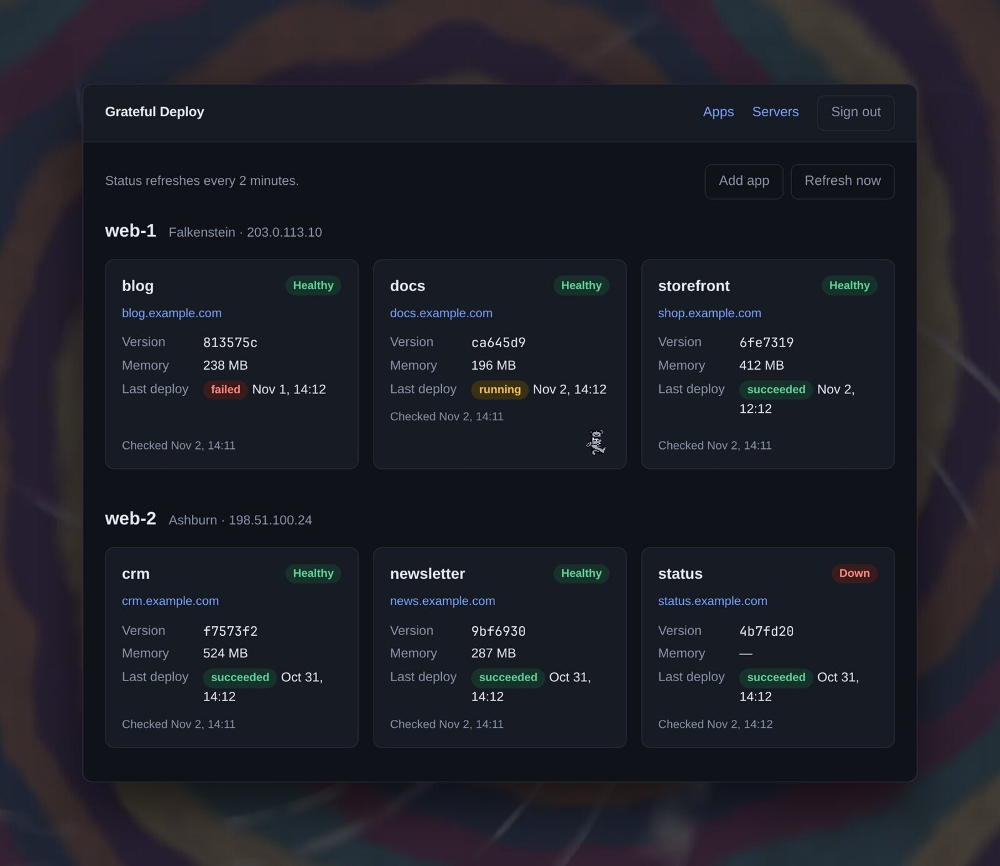

Last week I moved the Omarchy Guild website, [omarchyguild.com](https://omarchyguild.com/), from a Hetzner server in Ashburn, Virginia to Nuremberg, Germany. I made the move because the box I had it on in Ashburn also ran several other apps, and I was running out of memory. Omarchy Guild is still a free application that I pay for [out of my own pocket](https://buymeacoffee.com/joelgaff), and I needed a cost-effective way to give it more memory, and I found a great-priced box on their Hetzner's Nuremberg servers. The trade-off is slightly higher latency for folks in North America, but we have a good chunk of users in Europe and elsewhere, so of all the apps I had running on the Ashburn box, this was the best candidate to move.

To make the transition, I used an app I built with Claude called [Grateful Deploy](https://gratefuldeploy.com/). It's a Kamal deploy tool that lives locally on my machine and makes outbound connections as needed rather than living on the web. From it I can deploy a new commit, roll out a new version, or stop and start a container. And if you didn't already know, I'm a huge Grateful Dead fan, and that's where the name comes from.

Omarchy Guild had been served from Ashburn through Hatchbox, so there was no Kamal config to start from. I had my agent write one from scratch and stood up a full copy of the app in Nuremberg while Hatchbox kept serving the production site. To keep that staged copy from interfering with production, I ran it with no background jobs, so its nightly GitHub sync, daily backup, and alert emails couldn't fire. I loaded the most recent SQLite backup into it and checked the integrity and row counts.

Then, late one evening, I put the Ashburn site into maintenance mode for a few minutes, and stopped its job runner by hand, since maintenance mode stops web requests but not background writes. I took two backups, a SQLite copy kept on the old server and an upload to R2, and restored the R2 copy onto the new box, which both tests the backup and becomes the database that goes live.

The row counts matched Ashburn exactly. I started fresh queue and cache databases so nothing left over from staging could run, switched Kamal to the production domain, and pointed Cloudflare at the new box. kamal-proxy picked up its Let's Encrypt certificate on its own, and within a couple of minutes real traffic was hitting Nuremberg. Everything went smoothly, and omarchyguild.com is now served from Europe, with continuous backups and a nightly restore check.
